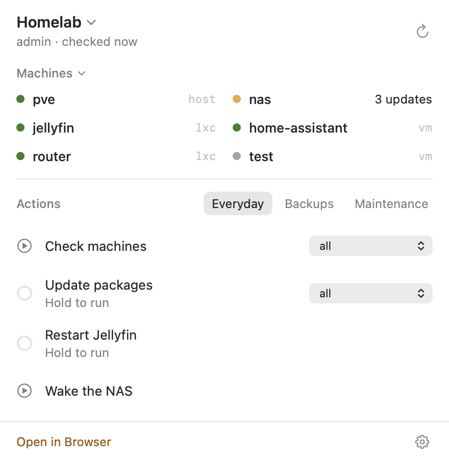
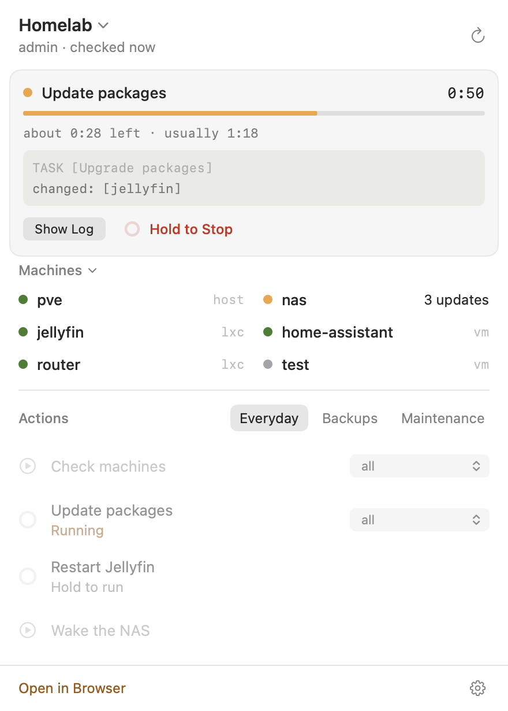

# Olive Lamp

Your [OliveTin](https://www.olivetin.app) in the macOS menu bar: run its actions, follow a running one, see the state
of your machines or containers, and get a notification when something fails.

<p align="center">
  <picture>
    <source media="(prefers-color-scheme: dark)" srcset="docs/images/panel-dark.png">
    
  </picture>
  <picture>
    <source media="(prefers-color-scheme: dark)" srcset="docs/images/running-dark.png">
    
  </picture>
</p>

It works with a stock OliveTin 3000; nothing has to be installed on the server.

- **Actions in their groups.** Fieldsets become tabs, several dashboards become groups. Arguments with choices are
  picked right in the panel; an action that needs free text opens in the browser.
- **Actions that change something run only after you hold them.** An action with a confirmation argument starts once
  you held its button, and Stop is a hold too. A reason, when OliveTin asks for one, is typed in the panel.
- **A running action reads like an instrument:** elapsed time, how long it usually takes, the last lines of its log,
  and the whole log a click away.
- **Machines, containers or any other entities.** Pick the entity type in the section heading. The state comes from a
  `state` or `status` field (`ok`, `running`, `exited`, `failed`, …), the name from `name` or Docker's `Names`.
- **Signs in the way your server expects:** nothing at all behind Tailscale Serve or for guests, an OliveTin API key,
  your own headers (a JWT, a Cloudflare Access service token), or the server's own sign-in page.
- **Several servers**, switched from the panel or the right-click menu.
- **Raycast.** The extension in [`raycast/`](raycast) lists the actions of the server Olive Lamp shows and runs them
  through the app.
- **English and Polish.**

## Privacy

Olive Lamp talks to the OliveTin servers you add and, once a day, reads the list of its releases on GitHub to offer
updates (you can turn that off). No analytics, no accounts. API keys, headers and session cookies stay in your
Keychain, and a credential is never sent along a redirect.

## Install

Needs macOS 26 or later. Download the DMG from [Releases](https://github.com/DabuSoft-pl/olive-lamp/releases), drag
Olive Lamp to Applications and add your OliveTin's address in Settings. Updates arrive through Sparkle.

## Build

Needs Xcode 26 and [XcodeGen](https://github.com/yonaskolb/XcodeGen).

```bash
make test         # domain, use case and adapter tests
make run          # Debug build, ad hoc signed
make screenshots  # the README images, from made-up data
```

The code follows Clean Architecture: `LampDomain` (rules), `LampApplication` (use cases and ports) and
`LampInfrastructure` (OliveTin's API, Keychain, files) are Swift packages, and the app target holds the SwiftUI
presentation and the macOS adapters.

## License

MIT
